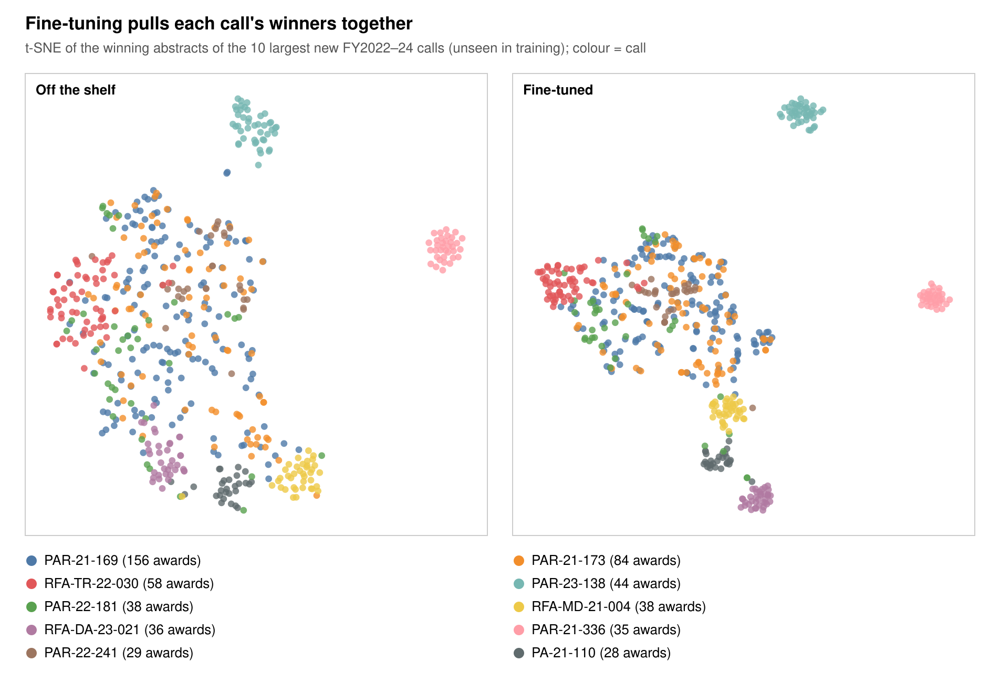

# Matching NIH calls to researchers: proof of concept

## Summary

What if a grant was described by the funding call it's likely to win, rather than by its wording or its authors? Then, our picture of what a grant proposal looks like would be based on how we wish to use it, rather than how it is written, or who it is written by. Comparing t-SNE representations from before and after training, we can see that a representation based on Notices of Funding Opportunity (NOFOs, or "calls") is similar to, but distinct from, semantic representation.

Our goal is to show that an institution could help researchers use their time efficiently, locating NOFOs that match up well with their existing body of work. This project was designed to use limited resources. Not every AI benefit has to come through a per-researcher license, a specialized search tool still asks each researcher to make time for it. A model run centrally, on the institution's own hardware outside working hours, can deliver each researcher's matches without asking anything of them.

The example product is an email that tells a researcher which open NIH calls fit their past work, and shows the earlier grant that makes each one a fit.

Example, with the PI anonymised:

> Dear Dr. [PI], we found three NIH funding opportunities that closely match your previous work and may be a good fit:
>
> 1. **RFA-AI-23-020**, pandemic-preparedness vaccine and antibody centers (U19). Closest match in your past work: *Preclinical development of a vaccine for Nipah virus* (FY2021)
> 2. **RFA-AI-22-037**, vaccines against enteric pathogens (R01). Closest match: the same Nipah grant
> 3. **RFA-AI-22-028**, therapeutics against antibiotic-resistant bacteria and fungi (R01). Closest match: the same Nipah grant

This PI later won the first call.

This proof of concept shows that a model trained only on public NIH data can make those matches. In a retrospective test, 28% of PIs who won an FY2022–24 call would have seen that call in a three-item email built from what was known in FY2021. BM25 serves as a lexical baseline representative of keyword-based search in commercial tools for NOFO matching such as Pivot-RP and SPIN. We show that our approach outperforms this.

## How it works

1. Collect. NIH ExPORTER bulk files give every funded project with its abstract, PIs, institution and the call (NOFO) it was funded under. The NIH Guide gives each call's text.
2. Pair. Each call is paired with the abstracts of the grants it funded. Those pairs are the training signal: "this call text led to these funded projects."
3. Train. A text-embedding model learns to place a call near the abstracts it funded.
4. Match. A new call is compared with every researcher's past abstracts. A researcher's score is their best-matching past abstract.
5. Email. Each researcher gets their top calls, each with the past grant that matched it. A research office can instead get each new call with its best-matched local researchers.

Three things were built, all from public data:

- A dataset linking 5,052 NIH calls to 81,333 abstracts of grants awarded under them (FY2008–2025). It is shared as code plus an ID and hash manifest, with no abstract text.
- A matching model, Qwen3-Embedding-4B fine-tuned on that data. On calls it never saw, it finds a real winner in the top 10 for 99% of calls (nDCG@10 0.86, against 0.57 for keyword search).
- A backtest of the email: 44,376 simulated emails. Recipients later won the suggested calls 62 times more often than random calls.

The known limits are listed at the end.

Code and steps to reproduce every number are in [REPRODUCE.md](REPRODUCE.md).

## Data

All data is public: NIH ExPORTER (FY1985–2025) and NIH Guide pages, downloaded 2026-11-02.

| Item | Count |
| --- | ---: |
| Calls with 5–200 funded grants (RFA, PAR, PA, PAS) | 5,052 |
| Funded grants with abstracts under those calls | 81,333 |
| Median grants per call | 9 |
| Training pairs (at most 40 per call) | 49,829 from 3,880 calls |
| Test calls, FY2022–24 | 769 (276 new, 493 reissues) |

The split is by time, to match real use. The model trains only on calls first awarded by FY2021 and awards made before FY2022, and is tested on calls first awarded in FY2022–24. Reissues of older calls during the test period are scored as a separate slice: they are the usual case in practice, while new calls measure how well the model generalises. Awards that share a project or an abstract with training are removed from test. Leakage checks pass, with no abstract, project or call family appearing in more than one split. Renewals that reword an earlier abstract slightly are not inflating the scores either: dropping every test winner whose abstract is 95% or more similar to a training abstract changes no metric by more than 0.005.

Calls with fewer than 5 grants (5,446) and 97 broad parent announcements were left out. Parent announcements describe a funding mechanism rather than a topic, and they fund much of NIH's investigator-initiated work.

## The matching model

Fine-tuning lifts nDCG@10 on unseen calls from 0.70 to 0.86 for new calls and from 0.26 to 0.57 for reissues, well ahead of keyword search on both.

Each test call ranks a pool of documents made up of its real winners plus an equal number of same-period grants from other calls.

| Model | New calls nDCG@10 | New calls hit@10 | Reissues nDCG@10 | Reissues hit@10 |
| --- | ---: | ---: | ---: | ---: |
| BM25 (keyword search) | 0.574 | 0.902 | 0.226 | 0.584 |
| Qwen3-4B, off the shelf | 0.700 | 0.927 | 0.263 | 0.619 |
| **Qwen3-4B, fine-tuned** | **0.860** | **0.986** | **0.574** | **0.962** |

hit@10 is the share of calls with at least one real winner in the top 10. Reissues score lower on nDCG because their pool is three times larger (16,584 documents) and includes older grants on the same topics. The model was fine-tuned (LoRA, rank 16) in 376 minutes on one H100. Adding keyword search to the fine-tuned model makes it worse.

## From model to email

The backtest asks whether the emails would have reached the right people. Every NIH PI with a pre-FY2022 abstract (44,376 PIs, 61,918 abstracts) gets a simulated email listing the three FY2022–24 calls that best match their past work.

| Measure | Result | Random |
| --- | ---: | ---: |
| PIs who won a test call whose email listed it | 28% | about 0.4% |
| Suggestions later won by the recipient | 1.40% | 0.022% |
| Research-office lists (3 local PIs per call) naming the winner, when the institution won | 37% | about 1% |

## Related projects

The same trained model supports other tools, because it places text by which calls would fund it instead of by general topic.

- Finding collaborators. Building a team is a pain point for researchers. Each match in an email could also list local colleagues whose work fits the same call, as possible co-investigators or writers of letters of support.
- Clustering grants by fundability. General-purpose embeddings group grants by subject. These embeddings were trained on which call funded which abstract, so their clusters follow the lines funders draw more closely. That could show which areas a portfolio covers and where the gaps are. A first test on unseen calls, below, shows that the embeddings do cluster by call.
- Reverse lookup from papers to calls. A separate model, trained on publication abstracts instead of grant abstracts, could match open calls to a researcher's papers. That would reach junior researchers with few or no grants, and researchers whose published work has moved beyond their past grants.
- Finding uncommon collaborators. 44% of new FY2022–24 co-PI pairs had little topical overlap, so similarity-based tools miss them. A model trained on past co-PI pairs could suggest these less obvious partners.

### First clustering test

On grants the model never saw, fine-tuning pulls each call's winners closer together. It also groups grants more strongly by funding mechanism and institute.

The test uses the winning abstracts of the FY2022–24 test calls, with no new training. For each grant, it counts how many of its 10 nearest neighbours share a label.

| Neighbours sharing… | New calls, off the shelf | New calls, fine-tuned | Reissues, off the shelf | Reissues, fine-tuned | Chance (new / reissue) |
| --- | ---: | ---: | ---: | ---: | ---: |
| The same call | 40% | 49% | 20% | 41% | 0.9% / 0.7% |
| The same activity code (R01, R21, …) | 54% | 70% | 32% | 63% | 14% / 7% |
| The same NIH institute | 63% | 71% | 60% | 70% | 7% / 8% |

Clustering into one group per call agrees better with the real calls after fine-tuning. NMI rises from 0.78 to 0.84 for new calls (2,725 grants, 276 calls) and from 0.61 to 0.74 for reissues (8,292 grants, 493 calls).

In the 10 largest new calls, calls defined by topic tighten into their own clusters, for example rare-disease protein pilots (RFA-TR-22-030), opioid and stimulant therapeutics (RFA-DA-23-021), and structural racism and health (RFA-MD-21-004). Calls defined by who may apply stay mixed. The SuRE awards (PAR-21-169, PAR-21-173) and the diversity-investigator R01s (PAR-22-181, PAR-22-241) fund any topic, so no model working from abstracts should separate them, and they still overlap after fine-tuning.

The jump in activity-code agreement shows that part of the gain comes from learning mechanism style. That is useful for a funding map, but it means clusters reflect what kind of award a grant is as well as its science.

## Limits of this proof of concept

- Public data has winners only, with no applications or rejections. A good match that the PI didn't apply for, or applied for and lost, counts as a miss, so every number here is a floor.
- PI histories are partial. Only abstracts from calls with 5–200 awards are embedded, so parent R01 work is missing, and only 49% of winners had any earlier abstract in the data.
- First-time applicants can't be matched. About a third of FY2022–24 winners had no earlier NIH award, so the tool has nothing to go on for them.
- Eligibility and timing are ignored. The backtest doesn't check career stage, mechanism or release dates, and treats all FY2022–24 calls as open at once.
- The evaluation pools are small. The model's ranking metrics use pools of about 5k–17k documents, while real use searches far more, so absolute recall is optimistic. Use the numbers to compare models, not as real-world rates.
- Institution names are left in abstracts, so the model could pick up on them. Measured overlap is rare (0.4% of pairs name the same institution on both sides), and the names weren't masked.
